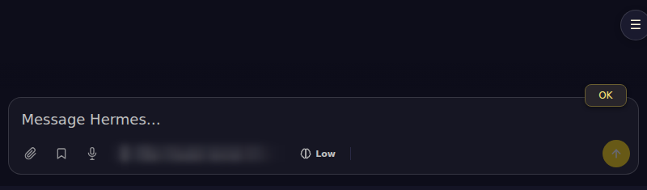
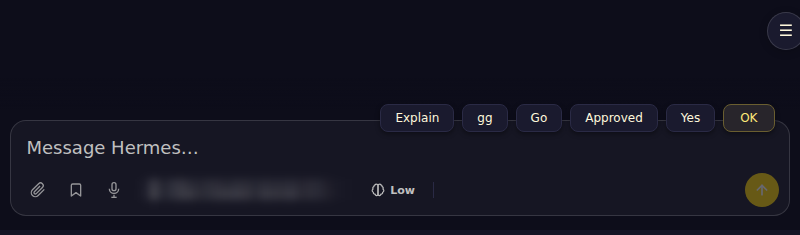
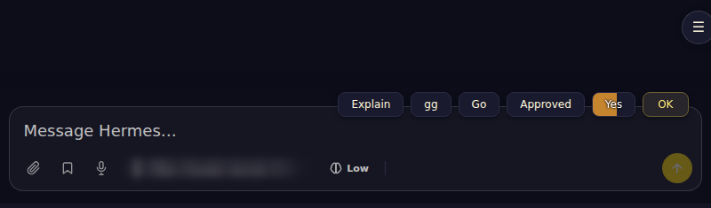
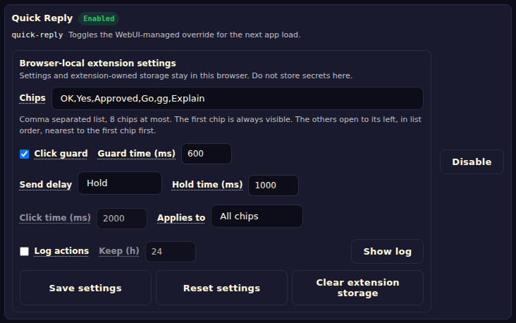

# Quick Reply

Quick Reply is a trusted local Hermes WebUI extension. It adds one-click reply chips above the
composer. Use it when the agent asks a question and your answer is one word: OK, Yes, Approved, Go.

> **No model calls. No outbound requests.**
> This extension never calls a model or any other server. It has no `fetch`, no `XMLHttpRequest`,
> no WebSocket, no beacon, no remote files and no telemetry. Settings and log stay in your browser.
>
> A chip works like typing: it puts the chip text in the composer and presses the WebUI's own Send.
> The WebUI then sends that one message as it does for any message. The extension adds nothing to it.



## What it does

- Shows the chip bar only when the agent is idle, the last message is from the assistant, and the
  composer is empty. It never overwrites a draft.
- Shows only the first chip (`OK`). The other chips open to its left when you hover the first chip,
  in list order. The second chip is nearest to `OK`.
- Sends the chip text as a normal user message.
- Protects against misclicks without a confirmation dialog (see below).
- Has an optional action log. It stores chip labels and times only, never chat text.



Default chips: `OK,Yes,Approved,Go,gg,Explain`. You can change the list (8 chips at most). The chip
text is sent as typed, so `ok` is sent as `ok`.

## Misclick protection

| Feature | Setting | What it does |
|---|---|---|
| Click guard | `guard`, `guard_ms` | Ignores presses for a short time after a new reply appears, and just after the chip group opens. Default 600 ms. |
| Send delay: Hold | `delay_mode` = `hold` | The chip fills from left to right while you hold the button. A full fill sends. Early release or leaving the chip cancels. Default 1000 ms. This is the default mode. |
| Send delay: Click | `delay_mode` = `click` | A click starts the fill. A full fill sends. A press anywhere on the page, or `Esc`, cancels. Default 2000 ms. |
| Send delay: Off | `delay_mode` = `off` | The first click sends. |
| Scope | `delay_scope` | `all` chips or `extra` chips only (all except the first). |



## Settings

Open **Settings -> Extensions -> Installed -> Quick Reply**. The settings are in 4 lines: chips,
click guard, send delay, and log. Each option name has a hover text. Press **Save settings** to
keep a change. A changed drop-down that you do not save returns to the old value after a reload.



| Key | Default | Range |
|---|---|---|
| `labels` | `OK,Yes,Approved,Go,gg,Explain` | 8 chips at most |
| `guard` | on | on / off |
| `guard_ms` | 600 | 0-3000 |
| `delay_mode` | `hold` | `hold`, `click`, `off` |
| `delay_hold_ms` | 1000 | 300-5000 |
| `delay_click_ms` | 2000 | 500-10000 |
| `delay_scope` | `all` | `all`, `extra` |
| `log` | off | on / off |
| `log_hours` | 24 | 1-168 |

## Install

This extension is not in the official gallery yet. Install it by hand. Your extension directory is
the value of `HERMES_WEBUI_EXTENSION_DIR`. In the commands below it is called `$EXT`.

1. Copy the files:

   ```bash
   git clone https://github.com/Piotr-Vasiuchonak-EPAM/hermes-webui-extention-quick-reply.git "$EXT/quick-reply"
   rm -rf "$EXT/quick-reply/.git"
   ```

2. Tell the WebUI to load it. Use one of these two ways.

   **Way A (tested by the author): record it as an installed package.** Add this entry under
   `installed` in `extension-install-manifest.json`. That file is in the WebUI state directory
   (the directory that holds `settings.json`). Keep the other entries as they are.

   ```json
   "quick-reply": {
     "version": "0.5.0",
     "files": ["assets/quick-reply.css", "assets/quick-reply.js", "extension.json", "manifest.json"],
     "installed_at": "2026-01-01T00:00:00+00:00"
   }
   ```

   **Way B (from `docs/EXTENSIONS.md`, not tested by the author): point the WebUI to the manifest.**
   Set `HERMES_WEBUI_EXTENSION_MANIFEST=quick-reply/manifest.json` in the WebUI environment and
   restart the WebUI. The WebUI accepts one manifest in this variable, so this way does not combine
   with other manifest-based extensions.

3. Refresh the page (F5). With way A a WebUI restart is not needed.

When this extension is in the official gallery, use **Settings -> Extensions** and click Install.
That records the package for you.

## Disable and uninstall

- Disable: **Settings -> Extensions -> Installed -> Quick Reply -> Disable**, then refresh.
- Uninstall: first press **Clear extension storage** on the settings card to remove the saved
  settings and the log. Then delete the `quick-reply` folder, remove its entry from
  `extension-install-manifest.json` (way A) or the variable (way B), and refresh.

## Action log

When `log` is on, the extension keeps the last 300 events for `log_hours` hours (default 24). Events
are: `press`, `hold_start`, `hold_cancel`, `hold_done`, `click_start`, `click_cancel`, `click_done`,
`blocked`, `send`, `send_skip`, `armed`, `mode_changed`, `page_load`. Each entry has a time, a
4-letter tab id, the event name, the mode and the scope. Press **Show log** to view, copy or clear
it. Old entries are deleted on page load, every 15 minutes, and on each write, also when `log` is
off.

## Trust model and permissions

The extension runs as trusted local code in the WebUI origin. It declares:

| Permission | Value |
|---|---|
| WebUI API read / write | none |
| Navigation | no |
| DOM | owns its chip bar and log dialog; does not change core views |
| Storage | owned keys only (settings and the log), no shared WebUI keys |
| External network | none |
| Sidecar, native host | none |
| Filesystem | none (serves bundled assets only) |

What the script touches in the page:

- Reads `S.session`, `S.messages` and `S.busy` (global WebUI state) to find the idle state and the
  last message role.
- Reads and writes the composer text area `#msg`, and the container `#composerBox`.
- Calls the global `send()`. If `send()` does not exist, it clicks `#btnSend`.
- Uses `window.hermesExt` and `window.HermesExtensionSettings` for settings and storage.
- In the settings card it moves the core input elements into 4 rows. See "Known limits".

It does not load remote scripts, does not call `fetch` or `XMLHttpRequest`, and does not use `eval`.
The only `navigator` call is the local clipboard copy in the log dialog (button **Copy**).

To check this yourself, run this in the repository folder. It must print nothing:

```bash
grep -n -E "fetch\(|XMLHttpRequest|WebSocket|EventSource|sendBeacon|import\(|https?://" assets/*.js assets/*.css
```

## Known limits

- **Core names.** The extension depends on these core names: `#msg`, `#composerBox`, `#btnSend`,
  `send()`, `S.session`, `S.messages`, `S.busy`. If a WebUI update renames them, the chip bar can
  stay hidden or fail to send.
- **Settings layout.** The WebUI has no layout option for extensions, so a script regroups the
  settings fields. If the expected field names are not found, it leaves the plain core grid. The
  settings still work.
- **Idle detection.** The bar shows only when the last message is from the assistant.
- **Debounce.** A second send within 1 s is ignored.
- **Touch.** Not tested on a touch screen.

## Compatibility and verification

- Tested on Hermes WebUI `exp-v0.52.666` (nesquena/hermes-webui), on Linux (WSL), in Chromium.
- WebUI API surface used: manifest bundle, `settings_schema`, owned storage.
- Tested by the author with a real mouse (hold, hover, click mode, click-anywhere stop), and with
  scripted pointer events in a headless browser.
- The catalog checks pass on a copy of the official library
  (`hermes-webui/hermes-webui-extensions`): `node scripts/validate-extensions.mjs` and
  `node scripts/scan-extension-safety.mjs`.

## Files

```text
extension.json          author metadata, permissions, settings schema
manifest.json           runtime loader manifest
assets/quick-reply.js
assets/quick-reply.css
screenshots/            4 images
CHANGELOG.md
LICENSE                 MIT
```

## License

MIT. See `LICENSE`.
